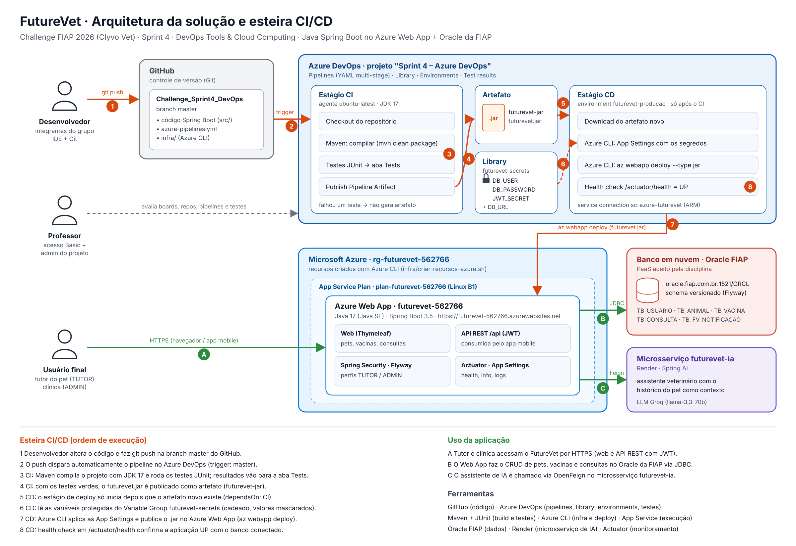

# FutureVet · Sprint 4 · DevOps Tools & Cloud Computing

Esteira **CI/CD no Azure DevOps** para o FutureVet, a plataforma de gestão veterinária do Challenge FIAP 2026 (parceria **Clyvo Vet**).
A cada alteração de código na branch `master`, o pipeline compila a aplicação Java, roda os testes automatizados, publica o artefato `.jar` e faz o deploy automático no **Azure Web App**, conectado ao **banco Oracle da FIAP**.

| | |
|---|---|
| Aplicação no ar | https://futurevet-562766.azurewebsites.net |
| Projeto no Azure DevOps | _link do projeto "Sprint 4 – Azure DevOps"_ |
| Vídeo de demonstração | _link do YouTube_ |
| Disciplina base | Java Advanced (Spring Boot) |

---

## 1. Descrição da solução

O **FutureVet** acompanha a saúde do pet de forma contínua. O **tutor** cadastra seus animais, registra a carteira de vacinação (com cálculo de próxima dose e reforços), agenda consultas e conversa com um assistente de IA que usa o histórico do pet como contexto. A **clínica** (perfil ADMIN) confirma, conclui ou cancela consultas, acompanha avisos gerados por eventos e o painel de monitoramento.
A mesma aplicação expõe uma **API REST com JWT** (`/api/...`) consumida pelo app mobile do grupo.

**Benefício para o negócio:** a clínica deixa de depender de ligações e papel para lembrar vacinas e retornos, o tutor enxerga o histórico do pet em um só lugar e a equipe ganha um fluxo de entrega automatizado — cada correção chega à produção testada, sem deploy manual.

### Stack de tecnologias

| Camada | Tecnologia |
|---|---|
| Linguagem / framework | Java 17 · Spring Boot 3.5 (Web, Thymeleaf, Validation, Security, JDBC, Actuator) |
| Autenticação | Spring Security (sessão na web, JWT na API) · perfis TUTOR e ADMIN |
| Versionamento do banco | Flyway (migrations `V1`…`V4`) |
| Banco de dados em nuvem | **Oracle Database da FIAP** (`oracle.fiap.com.br:1521/ORCL`) |
| Integrações | OpenFeign → microsserviço `futurevet-ia` (Spring AI + LLM Groq, hospedado no Render) |
| Build e testes | Maven · JUnit 5 · Spring Boot Test · MockMvc |
| Controle de versão | Git + GitHub |
| CI/CD | **Azure DevOps Pipelines** (YAML multi-stage), Library (variáveis protegidas), Environments |
| Nuvem | **Azure App Service** (Web App Linux, Java SE 17) · Azure CLI |

---

## 2. Diagrama da arquitetura + fluxo CI/CD



Arquivo vetorial: [`docs/arquitetura-cicd.svg`](docs/arquitetura-cicd.svg). Os números laranja mostram a ordem da esteira; as letras verdes mostram o uso da aplicação.

| Passo | Onde atua | O que acontece |
|---|---|---|
| 1 | Git / GitHub | O desenvolvedor altera o código e faz `git push` na `master` |
| 2 | Azure DevOps | O push dispara o pipeline automaticamente (`trigger: master`) |
| 3 | Maven + JUnit (CI) | Compila com JDK 17 e roda os testes; resultados na aba **Tests** |
| 4 | Pipeline Artifacts (CI) | Testes verdes → `futurevet.jar` publicado como artefato `futurevet-jar` |
| 5 | Azure DevOps (CD) | O estágio CD só começa depois que o artefato novo existe (`dependsOn: CI`) |
| 6 | Library | O CD lê os segredos do Variable Group `futurevet-secrets` (mascarados) |
| 7 | Azure CLI → App Service | Aplica as App Settings e publica o `.jar` no Web App (`az webapp deploy`) |
| 8 | Actuator | Health check `/actuator/health` confirma a aplicação **UP** com o banco conectado |
| A | Navegador / app mobile | Tutor e clínica acessam por HTTPS |
| B | JDBC → Oracle FIAP | CRUD de pets, vacinas e consultas |
| C | OpenFeign → Render | Assistente de IA do pet |

---

## 3. Banco de dados em nuvem

- **Oracle Database da FIAP** (PaaS aceito pela disciplina) — `jdbc:oracle:thin:@oracle.fiap.com.br:1521:ORCL`.
- O schema é criado e versionado pelo **Flyway** na subida da aplicação (`src/main/resources/db/migration` e `src/main/java/db/migration`). O DDL completo e comentado está em [`database/script_bd.sql`](database/script_bd.sql).
- Tabelas do CORE usadas no CRUD do vídeo: **`TB_ANIMAL`** (pet) e **`TB_VACINA`** (carteira de vacinação), relacionadas por `ID_ANIMAL`. Também existem `TB_USUARIO`, `TB_CONSULTA` e `TB_FV_NOTIFICACAO`.
- Usuário e senha do banco **não estão no código**: chegam ao Web App pelo pipeline de CD, a partir de variáveis protegidas.

> Nos testes automatizados do CI a aplicação sobe com um banco em memória descartável, só para validar o código sem depender de rede. A aplicação publicada na Azure usa exclusivamente o Oracle.

---

## 4. Estrutura do repositório

```
.
├── azure-pipelines.yml          # pipeline CI/CD (estágios CI e CD)
├── infra/
│   ├── criar-recursos-azure.sh  # Grupo de recursos, Plano, Web App e configurações (Azure CLI)
│   └── excluir-recursos-azure.sh
├── database/
│   ├── script_bd.sql            # DDL das tabelas
│   └── crud-evidencias.sql      # SELECTs usados no vídeo para provar cada operação do CRUD
├── docs/
│   ├── arquitetura-cicd.png/.svg
│   ├── ROTEIRO-VIDEO-DEVOPS.md  # roteiro de gravação
│   └── APLICACAO.md             # documentação funcional da aplicação (Java Advanced)
├── src/                         # código da aplicação Spring Boot + testes
├── microsservicos/futurevet-ia  # microsserviço de IA (deploy separado no Render)
└── pom.xml
```

---

## 5. Como montar o ambiente (How To)

### 5.1 Pré-requisitos

- Conta Azure (assinatura Azure for Students) com **Azure CLI** — o Azure Cloud Shell já tem tudo.
- Organização no **Azure DevOps** (https://dev.azure.com).
- Este repositório no GitHub, com a branch **`master`**.
- Usuário e senha do schema Oracle da FIAP.

### 5.2 Publicar este repositório no GitHub (branch master)

```bash
git init -b master
git add .
git commit -m "FutureVet: aplicação Spring Boot e documentação base"
git remote add origin https://github.com/joaocaetano1310/Challenge_Sprint4_DevOps.git
git push -u origin master
```
Deixe o repositório **público** (ou adicione o professor como colaborador) e confira em *Settings → Branches* que a branch padrão é `master`.

### 5.3 Criar os recursos na Azure (Azure CLI)

No Azure Cloud Shell (bash):

```bash
git clone https://github.com/joaocaetano1310/Challenge_Sprint4_DevOps.git
cd Challenge_Sprint4_DevOps
RM=562766 LOCATION=brazilsouth bash infra/criar-recursos-azure.sh
```

O script cria, nesta ordem:

| Recurso | Nome | Comando |
|---|---|---|
| Grupo de recursos | `rg-futurevet-562766` | `az group create` |
| Plano do App Service (Linux, B1) | `plan-futurevet-562766` | `az appservice plan create --is-linux --sku B1` |
| Web App Java 17 | `futurevet-562766` | `az webapp create --runtime "JAVA:17-java17"` |
| HTTPS obrigatório, TLS 1.2, Always On, health check | — | `az webapp update` / `az webapp config set` |
| Configurações da aplicação (perfil `oracle`, porta 80, Flyway etc.) | — | `az webapp config appsettings set` |
| Logs da aplicação | — | `az webapp log config` |

> Se a assinatura bloquear a região `brazilsouth`, rode com `LOCATION=eastus`. Se o Web App for criado com outro RM no nome, ajuste as variáveis `resourceGroup` e `webAppName` no topo do `azure-pipelines.yml`.

### 5.4 Projeto no Azure DevOps

**New project** com estas informações:

| Campo | Valor |
|---|---|
| Project name | `Sprint 4 – Azure DevOps` |
| Description | `Projeto para entrega da Sprint 4 do professor João Carlos Menk` + uma linha por integrante (ver abaixo) |
| Visibility | **Private** |
| Version control | **Git** |
| Work item process | **Scrum** |

Linhas de integrantes da descrição:

```
RM562074 - João Victor Caetano Alves da Silva - 2TDSPF
RM564115 - João Victor Bueno Castelini da Silva - 2TDSPF
RM565667 - Ryan Vetoriano - 2TDSPF
RM562766 - Felipe Furlanetto - 2TDSPF
RM564002 - Raul Rezende Iemini Aguiar - 2TDSPF
```

**Acesso do professor:** *Organization settings → Users → Add users* com o e-mail institucional do professor, **Access level: Basic**, adicionando ao projeto `Sprint 4 – Azure DevOps`. Depois, em *Project settings → Overview → Project administrators → Add administrator*, inclua o professor.

### 5.5 Service connection com a Azure

*Project settings → Service connections → New service connection → Azure Resource Manager*:

- Identity type: **App registration (automatic)** · Credential: **Workload identity federation**
- Scope level: **Subscription** → escolha a assinatura → Resource group: `rg-futurevet-562766`
- Service connection name: **`sc-azure-futurevet`**
- Marque **Grant access permission to all pipelines**

### 5.6 Variáveis protegidas (Library)

*Pipelines → Library → + Variable group*:

- Nome: **`futurevet-secrets`**
- Variáveis:

| Nome | Valor | Secret (cadeado) |
|---|---|---|
| `DB_URL` | `jdbc:oracle:thin:@oracle.fiap.com.br:1521:ORCL` | não |
| `DB_USER` | usuário do schema Oracle (RM) | **sim** |
| `DB_PASSWORD` | senha do schema Oracle | **sim** |
| `JWT_SECRET` | chave aleatória com 32+ caracteres | **sim** |

- Em **Pipeline permissions**, libere o grupo para o pipeline do FutureVet.

Gerar um `JWT_SECRET`: `openssl rand -base64 48`

### 5.7 Criar o pipeline

1. *Pipelines → New pipeline → **GitHub (YAML)*** → autorize o Azure Pipelines no GitHub → escolha `Challenge_Sprint4_DevOps`.
2. **Existing Azure Pipelines YAML file** → branch `master` → `/azure-pipelines.yml` → **Run**.
3. Na primeira execução o Azure DevOps pede permissão para o Variable Group, a service connection e o environment `futurevet-producao`: clique em **View → Permit** em cada um. A partir daí, todo push de código na `master` roda CI e CD sozinho.

### 5.8 Se aparecer "No hosted parallelism has been purchased or granted"

Organizações novas do Azure DevOps podem vir sem o agente gratuito da Microsoft. Duas saídas:

1. **Pedir a liberação gratuita** em https://aka.ms/azpipelines-parallelism-request (leva alguns dias úteis).
2. **Usar um agente próprio** (imediato), numa máquina Linux ou no Ubuntu do WSL:
   - Instale JDK 17, Maven e Azure CLI: `sudo apt install -y openjdk-17-jdk maven && curl -sL https://aka.ms/InstallAzureCLIDeb | sudo bash`
   - Exporte o JDK para a task do Maven: `echo 'export JAVA_HOME_17_X64=/usr/lib/jvm/java-17-openjdk-amd64' >> ~/.bashrc && source ~/.bashrc`
   - *Organization settings → Agent pools → Default → New agent → Linux*: baixe, rode `./config.sh` (URL da organização + Personal Access Token com escopo *Agent Pools: Read & manage*) e depois `./run.sh`
   - No `azure-pipelines.yml`, troque `usarAgenteProprio` para `'true'` e faça o push

---

## 6. Pipeline CI/CD explicado

Arquivo: [`azure-pipelines.yml`](azure-pipelines.yml) — YAML multi-stage.

### Estágio CI · Build, testes e artefato

| Task | O que faz |
|---|---|
| `checkout: self` | Baixa o código da `master` |
| `Maven@4` (`clean package`, JDK 17) | Compila e roda **todos os testes JUnit**; publica os resultados na aba **Tests** (`publishJUnitResults`). Se um teste falhar, o build para e nenhum artefato é gerado |
| `CopyFiles@2` | Separa o `target/futurevet.jar` |
| `PublishPipelineArtifact@1` | Publica o artefato **`futurevet-jar`** no Azure DevOps |

### Estágio CD · Deploy no Azure Web App

| Task | O que faz |
|---|---|
| `download: current` | Baixa o artefato que o CI acabou de gerar |
| `AzureCLI@2` — App Settings | Grava `DB_URL`, `DB_USER`, `DB_PASSWORD`, `JWT_SECRET` (vindos da Library, mascarados no log) e o número do build (`INFO_APP_BUILD`, visível em `/actuator/info`) |
| `AzureCLI@2` — deploy | `az webapp deploy --type jar`: publica o `.jar` no Web App e reinicia a aplicação |
| Health check | Consulta `https://futurevet-562766.azurewebsites.net/actuator/health` até receber `UP`; se não subir, o pipeline falha |

### Regras obrigatórias da pipeline

| Regra | Como foi atendida |
|---|---|
| I. Conectada ao repositório da aplicação | Pipeline YAML ligado ao repositório GitHub deste projeto |
| II. CI dispara a cada alteração na `master` | `trigger: branches: include: [master]` (alterações só em README/docs não disparam) |
| III. CD dispara após novo artefato | Estágio CD com `dependsOn: CI` + `condition: succeeded()`: só roda quando o artefato foi publicado |
| IV. Variáveis sensíveis protegidas | Variable Group `futurevet-secrets` com cadeado; mapeadas no `env:` da task e mascaradas (`***`) nos logs |
| V. Artefato gerado e publicado | `PublishPipelineArtifact@1` → `futurevet-jar` |
| VI. Etapa de testes no CI | `Maven@4` roda os testes e publica os resultados (`publishJUnitResults: true`) |
| VII. Deploy em Azure Web App | `az webapp deploy` no Web App `futurevet-562766` |

---

## 7. Testes automatizados

Ficam em `src/test/java/com/futurevet` e rodam no CI a cada push — **38 testes, 0 falhas** (`mvn clean package` validado em 03/11/2026):

| Classe | O que cobre |
|---|---|
| `FluxosTest` | Login com senha correta/incorreta, permissões por perfil, regras de agenda (horário, conflito, cancelamento), carteira de vacinação e reforço |
| `Sprint4Test` | Idiomas pt/en, notificações geradas por evento, assistente de IA (cliente simulado), health/métricas do Actuator, API REST com JWT e contrato do app mobile |
| `MigrationTest` | Migrations Flyway sobre um banco legado: preserva dados, gera sequências e protege senhas |
| `ProdutorEventosTest` | Mensageria: publicação no RabbitMQ, entrega direta sem broker e broker fora do ar sem perder aviso |

Rodar localmente: `./mvnw test` (Windows: `mvnw.cmd test`).

---

## 8. Testando a aplicação na nuvem (CRUD + evidência no banco)

URL: **https://futurevet-562766.azurewebsites.net**

1. **Cadastre-se** (`/registro`) como tutor e faça login.
2. **Create** — *Animais → + Cadastrar animal*: Thor · Cão · Labrador · 3 anos · Médio · 12,5 kg. Depois, *Vacinas → nova*: V10 para o Thor, data de hoje, próxima dose daqui a um ano.
3. **Read** — listas de animais e vacinas.
4. **Update** — editar o Thor: peso 13,8.
5. **Delete** — excluir a vacina V10 e depois o pet Thor (pets com histórico não podem ser excluídos, por isso a vacina sai primeiro).

Depois de **cada** operação, rode o SELECT correspondente de [`database/crud-evidencias.sql`](database/crud-evidencias.sql) no SQL Developer conectado ao Oracle da FIAP.

Também é possível pela API REST (Swagger em `/swagger-ui.html`): `POST /api/auth/login` → `POST/GET/PUT/DELETE /api/animais` e `/api/vacinas` com o token JWT.

### Monitoramento

- `GET /actuator/health` — saúde da aplicação e do banco (usado pelo CD e pelo health check do App Service)
- `GET /actuator/info` — versão e número do build publicado
- Portal Azure → Web App → **Log stream** — logs em tempo real

---

## 9. Segurança

- Nenhuma senha, usuário de banco ou token no código: tudo vem da Library do Azure DevOps.
- Logs do pipeline mascaram os valores secretos.
- Web App com HTTPS obrigatório, TLS 1.2 mínimo e FTP desativado.
- Senhas dos usuários gravadas com BCrypt; API protegida por JWT; telas protegidas por perfil.

---

## 10. Limpeza dos recursos

Depois da correção, para não consumir créditos:

```bash
RM=562766 bash infra/excluir-recursos-azure.sh
```

---

## 11. Integrantes

| Nome | RM | Turma |
|---|---|---|
| João Victor Caetano Alves da Silva | RM562074 | 2TDSPF |
| João Victor Bueno Castelini da Silva | RM564115 | 2TDSPF |
| Ryan Vetoriano | RM565667 | 2TDSPF |
| Felipe Furlanetto | RM562766 | 2TDSPF |
| Raul Rezende Iemini Aguiar | RM564002 | 2TDSPF |
